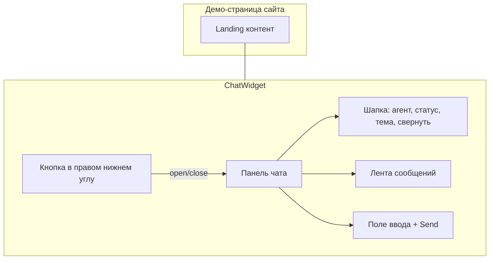

# Frontend виджета чата ИИ-агента (стиль Jivo)

## Контекст

Репозиторий [`D:\Students\wed1500\11\ai-chat`](D:\Students\wed1500\11\ai-chat) сейчас без исходников — только [`.cursor/rules/mock-data.mdc`](.cursor/rules/mock-data.mdc). Бэкенд не подключаем: один источник данных в `src/mocks/`, ответы ассистента — имитация задержки в клиенте.

## Целевой UX (как Jivo)



| Элемент | Поведение |
|---------|-----------|
| FAB | Фиксированно `bottom-right`, иконка чата, badge при непрочитанном (опционально на моках) |
| Панель | ~380×520px на десктопе, на мобиле почти на весь экран снизу; анимация появления |
| Шапка | Имя агента, «В сети», кнопки свернуть/закрыть, переключатель темы |
| Сообщения | Пузыри user справа / assistant слева, аватар бота, время, автоскролл вниз |
| Ввод | Enter — отправить, Shift+Enter — новая строка; disabled во время «печати» бота |
| Старт | При первом открытии — приветствие из мока + быстрые подсказки (chips) |

## Стек

- **Vite** + **React 18** + **TypeScript** (экосистема JavaScript)
- **CSS**: CSS Modules или один глобальный `tokens.css` с CSS-переменными для light/dark (без тяжёлого UI-kit — виджет должен быть лёгким)
- Флаг моков: `import.meta.env.VITE_USE_MOCKS` (по умолчанию `true` в dev), логика в [`src/api/chatClient.ts`](src/api/chatClient.ts)

## Структура файлов

```
src/
  main.tsx
  App.tsx                    # демо-лендинг + <ChatWidget />
  types/chat.ts              # Message, Conversation, AgentProfile
  mocks/
    agent.mock.ts            # имя, аватар (инициалы/цвет), статус
    conversations.mock.ts    # 2–3 диалога, 10+ сообщений (для dev/тестов)
    quickReplies.mock.ts
  api/chatClient.ts          # sendMessage → задержка + шаблонный ответ / ротация из моков
  hooks/
    useTheme.ts              # light | dark, localStorage key `ai-chat-theme`
    useChat.ts               # messages state, open/closed, sending, send()
  components/widget/
    ChatWidget.tsx
    ChatLauncher.tsx
    ChatPanel.tsx
    ChatHeader.tsx
    MessageList.tsx
    MessageBubble.tsx
    ChatInput.tsx
    QuickReplies.tsx
    TypingIndicator.tsx
  styles/
    theme.css                # [data-theme="light"|"dark"]
    widget.module.css
```

## Типы и моки (правило mock-data)

- [`src/types/chat.ts`](src/types/chat.ts): `id`, `role: 'user' | 'assistant'`, `content`, `createdAt` (ISO), опционально `status: 'sending' | 'sent'`.
- [`src/mocks/conversations.mock.ts`](src/mocks/conversations.mock.ts): минимум **3** диалога, **10+** сообщений суммарно, русские тексты, стабильные id (`conv-1`, `m1`…).
- Активный чат виджета — **один поток** (новый диалог при первом сообщении пользователя); мок-диалоги можно подгружать в dev через query `?seed=conv-2` (необязательно, но удобно для проверки).

## Логика чата (без API)

[`src/hooks/useChat.ts`](src/hooks/useChat.ts):

1. Инициализация: приветственное сообщение ассистента из `agent.mock.ts`.
2. `sendMessage(text)`: append user → `typing` 800–1500ms → append assistant (из `chatClient` — короткий ответ с упоминанием текста пользователя или случайная фраза из пула 8–10 реплик).
3. Ошибки сети не моделируем (моки всегда успешны).

## Тема

[`src/hooks/useTheme.ts`](src/hooks/useTheme.ts):

- `document.documentElement.dataset.theme = 'light' | 'dark'`
- Первый рендер: читать `localStorage`, иначе `prefers-color-scheme`
- Кнопка в шапке виджета (иконка sun/moon)

## Демо-страница

[`src/App.tsx`](src/App.tsx): простой «сайт» (hero + текст), чтобы виджет выглядел как встраиваемый — фон страницы нейтральный, виджет поверх (`z-index`).

## Скрипты и документация

- `package.json`: `dev`, `build`, `preview`
- В [README.md](README.md) одна строка: `VITE_USE_MOCKS=true npm run dev`

## Визуальные ориентиры Jivo

- Скругление панели ~12–16px, тень, акцентный цвет шапки (зелёный/брендовый — настраиваемая CSS-переменная `--chat-accent`)
- Launcher: круг 56–60px, та же accent
- Assistant bubble: светлый фон в light / приглушённый в dark; user bubble: accent

## Что сознательно не входит в первую итерацию

- Реальный WebSocket/SSE к LLM
- Отдельный npm-пакет для embed (`<script src="...">`) — можно добавить вторым entry в Vite позже
- Загрузка файлов, оценка диалога, CRM — только UI-заглушки не делаем, чтобы не раздувать scope

## Проверка после реализации

- `npm run dev`: лендинг + открытие виджета, отправка сообщений, typing, quick replies
- Переключение темы сохраняется после перезагрузки
- `npm run build` без ошибок TypeScript
